## Hi there 👋

<!--
**LOKESH-sys365/LOKESH-sys365** is a ✨ _special_ ✨ repository because its `README.md` (this file) appears on your GitHub profile.

Here are some ideas to get you started:

- 🔭 I’m currently working on ...
- 🌱 I’m currently learning ...
- 👯 I’m looking to collaborate on ...
- 🤔 I’m looking for help with ...
- 💬 Ask me about ...
- 📫 How to reach me: ...
- 😄 Pronouns: ...
- ⚡ Fun fact: ...
-->

## 💫 About Me:

I'm currently working on  
Improving my programming skills as a B.Tech CSE student and building small projects to strengthen my understanding of computer science concepts. Building full-stack and AI-integrated projects with Java, Spring Boot and React, including LLM/RAG features using Ollama and pgvector.

I'm looking to collaborate on  
Beginner-friendly development projects and innovative ideas that help me gain practical experience in software development. Also open-source projects  and backend or AI-native applications.

I'm currently learning  
Java programming and strengthening my foundation in core computer science subjects. Also system design, microservices and DSA, while preparing for SDE internships.

## 🌐 Socials:

## 💻 Tech Stack:

  

## 🚀 Featured Projects:

- **Hotel Management System**: Spring Boot + React app with a RAG module
- **Elderly Agent AI (Maya)**: offline-first voice assistant for elderly users
- **GitHub PR Reviewer**: Spring Boot tool for automated PR reviews

## 📊 GitHub Stats:

## 📊 GitHub Stats:

---
